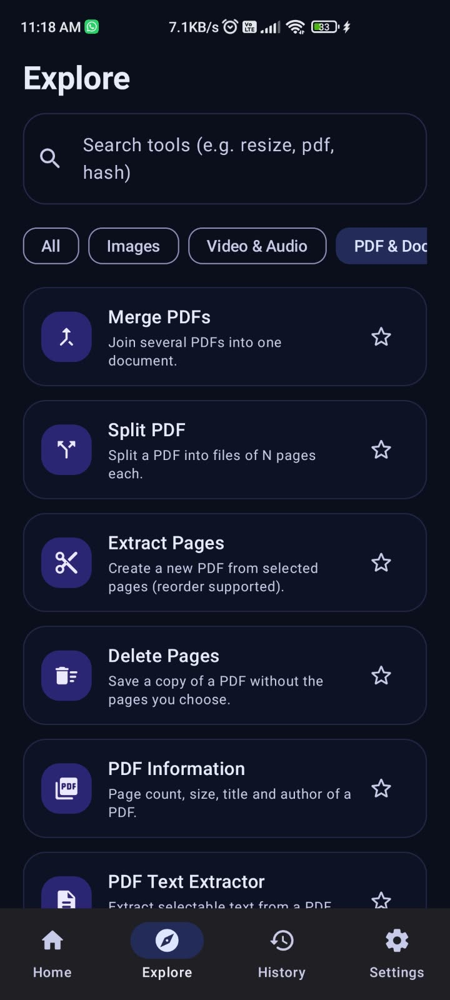
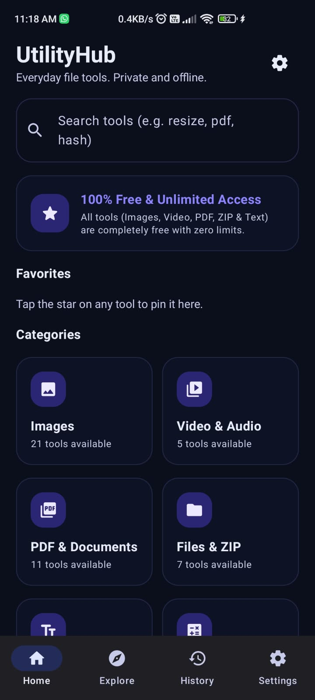
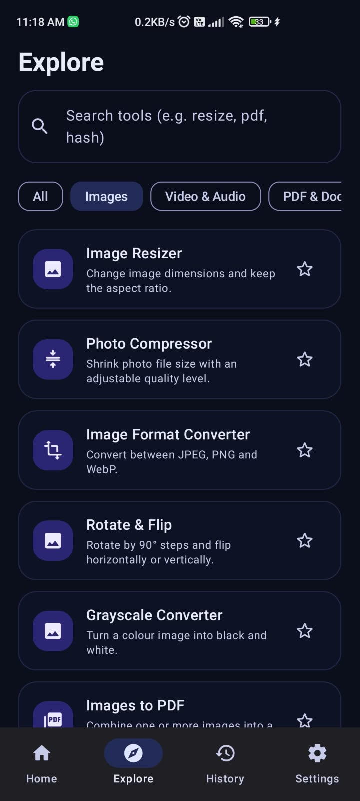

# UtilityHub 🚀

**UtilityHub** is a modern, privacy-focused, offline-first Android utility suite built with **Kotlin, Jetpack Compose (Material 3 Glassmorphism)**, and **Architecture Components**.

Architected and developed by **Danish Baigh**.

---

## 📱 App Screenshots

<div align="center">
  
  &nbsp;&nbsp;&nbsp;&nbsp;
  
  &nbsp;&nbsp;&nbsp;&nbsp;
  
</div>

---

## ✨ Features

UtilityHub offers a complete collection of powerful local processing utilities grouped across 6 major categories:

- **📸 Image Tools**:
  - **Passport Photo Maker**: Convert photos to standard passport/visa sizes (`35 × 45 mm`, `2 × 2 in`, etc.) with automatic background replacement to **Solid White**, light blue, or off-white.
  - **Background Color Changer**: Replace photo backgrounds with White, Blue, Red, Grey, or custom solid colors.
  - **Image Resizer, Photo Compressor & Format Converter**: Adjust image dimensions, compress file sizes (by target KB/MB or quality percentage), and convert between JPEG, PNG, and WebP.
  - **Images to PDF**: Combine multiple photos into a single PDF document.
  - **Cropper, Watermark, Border & Grayscale**: Crop to preset aspect ratios, add text watermarks with custom position and opacity, add borders, or convert to monochrome.
  - **Metadata Inspector, Color Picker & Base64 Converter**: Inspect EXIF/GPS metadata, extract dominant colors, and encode/decode Base64 strings.

- **📄 PDF & Document Utilities**:
  - Merge PDFs, Split PDFs, Extract/Reorder Pages, Delete Pages, Extract Text, Add Page Numbers, Watermark PDFs, and Convert Images/Text to PDF.

- **📁 Files & ZIP Archives**:
  - Create and Extract encrypted ZIP archives safely, Generate File Hashes (MD5, SHA-1, SHA-256), Batch Rename files, Find Duplicate files, and View CSV files.

- **🎬 Video & Audio Tools**:
  - Video to Audio Extractor (AAC/M4A), Lossless Video & Audio Trimmer, Video Thumbnail Extractor, and Media Information Inspector.

- **🔤 Text & Developer Tools**:
  - Word & Character Counter, Text Case Converter, Line Deduplicator & Sorter, JSON Formatter & Validator, Base64 & URL Encoder/Decoder, Cryptographic Password & UUID Generator, Regex Tester, and Epoch Timestamp Converter.

- **⏱️ Everyday Calculators**:
  - Unit Converter, Percentage Calculator, Age & Date Difference Calculator, Scientific Calculator, Stopwatch & Countdown Timer, Notes Scratchpad, and Text to Speech.

---

## 🔒 Security & Privacy

- **100% On-Device Processing**: Photos, videos, documents, and archives never leave your device.
- **Secure Authentication**: Accounts via Firebase Authentication with mandatory email verification, input sanitization, and brute-force attempt lockout.
- **Zero Telemetry**: No analytics tracking, background data logging, or advertising SDKs.
- **Storage Access Framework (SAF)**: Uses standard Android file pickers to access files without asking for unnecessary system privileges.

---

## 🎨 Design System

- **Apple / iOS Inspired Glassmorphism Aesthetic**: Translucent frosted containers, ambient gradient backdrops, 20.dp rounded shapes, and clean Material 3 typography.
- **Adaptive Light & Dark Themes**: Fully supports system-wide light and dark mode preferences.

---

## 🛠️ Architecture & Tech Stack

- **Language**: Kotlin 2.0.21
- **UI Framework**: Jetpack Compose (BOM 2024.12.01), Material 3
- **Navigation**: Jetpack Navigation Compose
- **Local Persistence**: DataStore Preferences, Room Database
- **Backend / Identity**: Firebase Authentication
- **Document & QR Libraries**: PDFBox-Android, ZXing Core
- **Build System**: Android Gradle Plugin 8.7.3, Gradle 8.9 (JDK 17)

---

## 🚀 Building & Running

### Prerequisites
- Android Studio Ladybug (or newer) with JDK 17+
- Android SDK 35 (Android 15) installed

### Steps
1. Clone the repository:
   ```bash
   git clone https://github.com/danishtechie/UtilityHub.git
   cd UtilityHub
   ```
2. Open the project in **Android Studio**.
3. Let Gradle sync and download dependencies.
4. Select `:app` target and click **Run** (▶) on an emulator or connected device (Android 8.0+ / API 26+).

---

## ✉️ Support & Feedback

For questions, bug reports, or feature requests, contact **Danish Baigh**:
- **Email**: [dmaqbool006@gmail.com](mailto:dmaqbool006@gmail.com)
- **Instagram**: [@dan.ishh6](https://www.instagram.com/dan.ishh6/)

---

## 📄 License

Distributed under the **Apache License 2.0**. See `THIRD_PARTY_NOTICES.md` for open-source library notices.
